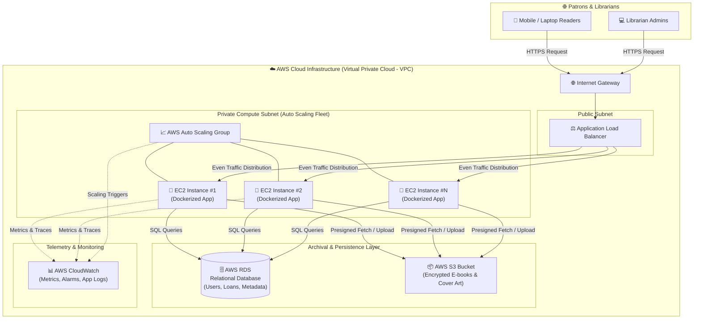
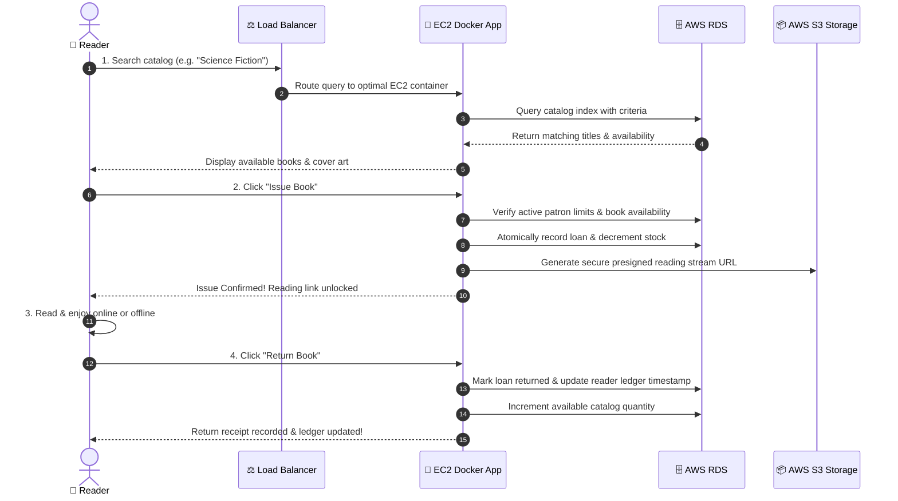

<div align="center">

# 🏛️ NEXUS DIGITAL LIBRARY
### *A Cloud-Native Sanctuary for Readers & Knowledge Keepers*

[-2E7D32?style=for-the-badge&logo=google-classroom&logoColor=white)](https://github.com/7Hansika7/KLH_CSE_Y25_2026-27_CDIS_S4_Team-18)
[](https://github.com/7Hansika7/KLH_CSE_Y25_2026-27_CDIS_S4_Team-18)
[](https://github.com/7Hansika7/KLH_CSE_Y25_2026-27_CDIS_S4_Team-18)
[](https://aws.amazon.com/)
[](https://www.docker.com/)
[](#)

<br/>

> *"In one line: a smart online library that grows with its readers."*  
> **Search · Borrow · Read · Recommend — Powered by AWS Cloud Infrastructure**

<br/>

[🏛️ Grand Foyer](#-the-grand-foyer-abstract) •
[📜 The Catalog Dilemma](#-the-catalog-dilemma-problem-statement) •
[✨ Library Wings](#-library-wings-core-functionalities) •
[☁️ Cloud Blueprint](#️-the-cloud-blueprint-aws-architecture) •
[🔄 A Book's Journey](#-a-books-journey-circulation-lifecycle) •
[🔮 Recommendation Desk](#-the-recommendation-desk-smart-discovery) •
[🛡️ The Archival Vault](#️-the-archival-vault-security--privacy) •
[🚀 Patron Setup](#-entering-the-library-local--cloud-setup) •
[🗺️ Future Additions](#️-future-additions-to-the-stacks) •
[👥 Curators](#-curators--team-credits)

---

</div>

<br/>

## 🏛️ The Grand Foyer (Abstract)

Welcome to **Nexus Digital Library**, an enterprise-grade, cloud-native digital repository designed to bring the traditional sanctuary of books into the modern, ubiquitous digital age. 

Physical libraries have sheltered human knowledge for centuries, yet modern readers require immediate access, personalized literature curation, and reliable uptime from any corner of the globe. Nexus bridges this gap:
* Readers seamlessly **search the stacks**, **borrow and return e-books with a single click**, and preserve an accurate, lifelong **reading history**.
* Powered by an intelligent **Recommendation Engine**, the library continuously learns patron preferences and delivers tailor-made suggestions that spark curiosity.
* Engineered entirely on **Amazon Web Services (AWS)** and containerized with **Docker**, Nexus guarantees fault-tolerant concurrency, elastic scaling during peak reading hours, and ironclad archival privacy.

> 💡 **Core Vision**: *Think of it as a world-class public library that comfortably fits inside your phone or laptop, accessible 24 hours a day, 7 days a week.*

---

## 📜 The Catalog Dilemma (Problem Statement)

Traditional brick-and-mortar libraries and obsolete paper systems struggle under everyday frictions:

| The Dusty Stacks (Traditional Pain Points) | 🏛️ The Nexus Digital Solution |
| :--- | :--- |
| **🔍 Hard to Find**<br/>Scanning physical aisles or static catalogs takes excessive time; misplaced books are lost forever. | **⚡ Instant Multi-Vector Search**<br/>Query books in milliseconds by Title, Author, Category, or Topic. |
| **📋 Hard to Track**<br/>Paper registers and manual ledgers are prone to human error, physical wear, and misplacement. | **🗄️ Automated Digital Ledger**<br/>Real-time circulation tracking with zero paper waste and immutable loan history. |
| **🤷 Hard to Choose**<br/>Patrons often leave empty-handed, unsure of what book to read next without personal guidance. | **🔮 Intelligent Recommendation Engine**<br/>Behavioral affinity modeling that surfaces books readers are guaranteed to cherish. |
| **⏳ Constrained Operating Hours**<br/>Physical facilities close on evenings and weekends, shutting out busy learners. | **🌐 24/7 Ubiquitous Cloud Access**<br/>Always open, globally reachable from mobile devices, laptops, or tablets. |

### 🎯 Motivation
1. **Reading Is Going Digital**: More people read and learn online than ever before.
2. **Save Time**: No more searching physical shelves, waiting in checkout queues, or dealing with physical paperwork.
3. **Personalized Literary Exploration**: Suggestions help every reader discover books they will genuinely love.

---

## ✨ Library Wings (Core Functionalities)

Nexus Digital Library is split into two specialized wings: **The Patron Wing** and **The Librarian's Desk**.

```
                           ┌───────────────────────────────┐
                           │   🏛️ NEXUS DIGITAL LIBRARY     │
                           └───────────────┬───────────────┘
                                           │
                   ┌───────────────────────┴───────────────────────┐
                   ▼                                               ▼
         📖 FOR PATRONS (READERS)                         🗝️ FOR LIBRARIANS
  ├── 🔍 Multi-Facet Search & Filter              ├── 📚 Catalog & Book Management
  ├── 📥 1-Click Borrow & Digital Loan            ├── 👥 Borrower Registry & Audits
  ├── 📤 Instant Online Return                    ├── 📊 Circulation Analytics
  ├── 📜 Comprehensive Reading Ledger             └── 🛡️ Access & Inventory Controls
  └── 🔮 Tailored Reading Suggestions
```

### 📖 1. The Patron Experience
* **Deep Catalog Search**: Look up any book by title, author, category, or keyword with fast querying.
* **Frictionless Circulation**: Issue an available e-book with a single click; digital return is just as instantaneous.
* **Personal Reading Ledger**: Maintain an organized record of current borrowings, completed books, and historical reading milestones.
* **Curated Discoveries**: Real-time reading recommendations generated from user affinity patterns.

### 🗝️ 2. The Librarian's Desk
* **Digital Inventory Ingestion**: Add, catalog, tag, and publish new e-books and cover art to the cloud storage vault.
* **Circulation Surveillance**: Real-time visibility into active loans, overdue statuses, and borrower identities.
* **Autonomous Scalability**: Zero maintenance of physical hardware; cloud automation handles catalog expansion.

---

## ☁️ The Cloud Blueprint (AWS Architecture)

Nexus is engineered following the **AWS Well-Architected Framework**, combining isolation, containerization, elastic scalability, and managed persistence.



### 🛠️ AWS Building Blocks Breakdown

| Service | Cloud Role in Nexus | Operational Advantage |
| :--- | :--- | :--- |
| **🐳 Docker** | Containerization | Packages the application code, libraries, and runtime into lightweight, reproducible containers. |
| **🌐 AWS VPC** | Network Isolation | Carves out an isolated virtual private network with public subnets for ingress and private subnets for sensitive assets. |
| **⚖️ Elastic Load Balancer (ALB)** | Ingress Traffic Distribution | Distributes incoming HTTP/HTTPS reader traffic evenly across healthy compute instances, eliminating hotspots. |
| **💻 AWS EC2** | Scalable Compute Instances | High-performance virtual machines hosting Docker application containers to process queries, loans, and recommendations. |
| **📈 AWS Auto Scaling** | Fleet Elasticity | Automatically provisions new EC2 instances during peak reading times and scales down during lulls to save costs. |
| **🗄️ AWS RDS** | Structured Storage | Managed relational database engine hosting patron profiles, circulation records, catalog metadata, and transaction tables. |
| **📦 AWS S3** | Object Storage | Highly available 99.999999999% durable storage holding digital e-book files (PDF/EPUB) and high-resolution cover graphics. |
| **📊 AWS CloudWatch** | Unified Observability | Collects system performance metrics, application logs, and triggers automated scaling alarms upon elevated CPU or latency. |

---

## 🔄 A Book's Journey (Circulation Lifecycle)

Every transaction within Nexus Digital Library follows a structured digital lifecycle:



---

## 🔮 The Recommendation Desk (Smart Discovery)

Nexus ensures no reader ever feels lost in the aisles. The system features a continuous **Affinity Feedback Loop**:

```
 ┌───────────────┐        ┌───────────────────────┐        ┌───────────────────────┐
 │   1. BORROW   │  ───►  │       2. NOTICE       │  ───►  │       3. MATCH        │
 │ Reader issues │        │ Algorithm tracks      │        │ Discovers related un- │
 │ books online  │        │ authors, tags, genres │        │ read titles in catalog│
 └───────────────┘        └───────────────────────┘        └───────────┬───────────┘
                                                                       │
                                                                       ▼
                                                           ┌───────────────────────┐
                                                           │      4. SUGGEST       │
                                                           │ Delivers custom feed  │
                                                           │ on Patron Home Page   │
                                                           └───────────────────────┘
```

### 🧪 Real-World Scenario
> **Patron Profile**: A reader borrows three titles: *Dune*, *Foundation*, and *Neuromancer*.  
> **Affinity Vector**: `[Genre: Science Fiction, Space Opera, Cyberpunk; Authors: Herbert, Asimov, Gibson]`  
> **Recommendation Output**: The next time the reader visits the Grand Foyer, their personalized shelf highlights *Snow Crash*, *The Left Hand of Darkness*, and *Rendezvous with Rama*.

---

## 🛡️ The Archival Vault (Security & Privacy)

Data integrity and patron privacy are non-negotiable foundations of Nexus:

```
                  ┌───────────────────────────────────────────────┐
                  │          🛡️ NEXUS DEFENSE IN DEPTH            │
                  └───────────────────────────────────────────────┘
                                          │
        ┌───────────────────┬─────────────┴─────┬───────────────────┐
        ▼                   ▼                   ▼                   ▼
 🔒 PRIVATE SUBNETS   🔑 IAM POLICIES     📜 STRICT RBAC      💾 DAILY BACKUPS
 RDS database is     S3 files served     Separation between  Point-in-time RDS
 completely shielded via temporary      Patron, Librarian,  snapshots safeguard
 from public traffic presigned links     and Admin roles     against data loss
```

* **Zero Public Exposure for Databases**: The AWS RDS database resides solely in private VPC subnets with strict security groups accepting traffic exclusively from compute nodes.
* **Cryptographic Book Protection**: E-book files in AWS S3 are encrypted at rest using AES-256 (SSE-S3/KMS) and accessed only via short-lived AWS presigned URLs.
* **Role-Based Access Control (RBAC)**: Fine-grained access distinctions ensure patrons cannot tamper with inventory and librarians cannot view reader passwords.
* **Disaster Recovery**: Automated point-in-time snapshots and multi-AZ availability guard against hardware degradation.

---

## 📊 Benefits at a Glance

| For Readers (Patrons) | For Libraries & Academic Institutions |
| :--- | :--- |
| ⏱️ **Saves Hours**: Zero shelf-searching and zero physical queueing. | 📈 **Elastic Growth**: Scales gracefully from 50 to 50,000 concurrent patrons. |
| 🌍 **Always Accessible**: Study late at night or on-the-go from any web browser. | 📉 **Zero Paper Waste**: Eliminates physical index cards and lost paper registries. |
| 🎯 **Personalized Taste**: Tailored book suggestions keep readers inspired. | 🔒 **Audit-Ready Security**: Automated logs and backups safeguard literary records. |

---

## 🚀 Entering the Library (Local & Cloud Setup)

### 📋 Prerequisites
* [Docker](https://www.docker.com/) & Docker Compose installed
* [AWS CLI](https://aws.amazon.com/cli/) configured with proper IAM credentials
* Node.js or Python runtime environment

### 🔧 1. Clone the Stacks
```bash
git clone https://github.com/7Hansika7/KLH_CSE_Y25_2026-27_CDIS_S4_Team-18.git
cd KLH_CSE_Y25_2026-27_CDIS_S4_Team-18
```

### ⚙️ 2. Configure Environment Parameters
Create a `.env` file in the project root:
```env
# Application Port & Database Config
PORT=8080
DB_HOST=your-rds-endpoint.amazonaws.com
DB_NAME=nexus_library
DB_USER=library_admin
DB_PASS=super_secure_vault_pass

# AWS S3 Storage
AWS_REGION=us-east-1
S3_BUCKET_NAME=nexus-digital-library-books
AWS_ACCESS_KEY_ID=your_access_key
AWS_SECRET_ACCESS_KEY=your_secret_key
```

### 🐳 3. Launch via Docker
```bash
# Build the container image
docker build -t nexus-digital-library:latest .

# Run the containerized digital library
docker run -d -p 8080:8080 --env-file .env --name nexus-library nexus-digital-library:latest
```
Visit `http://localhost:8080` to enter the Grand Foyer!

---

## 🗺️ Future Additions to the Stacks

Nexus continues to expand its digital shelves. Upcoming milestones include:
- [ ] **Community Literary Reviews**: Patron rating system with spoiler-tagged reviews and community discussions.
- [ ] **Automated Return Reminders**: Integration with **AWS SNS / SES** for automated email and SMS due-date notifications.
- [ ] **Native Mobile Application**: Dedicated iOS and Android client built with Flutter.
- [ ] **Semantic Vector Search**: Advanced vector embeddings (powered by pgvector or OpenSearch) for natural language queries like *"books about melancholy space travelers"*.
- [ ] **Audiobook Streaming Player**: In-browser audio streaming with playback position sync.

---

